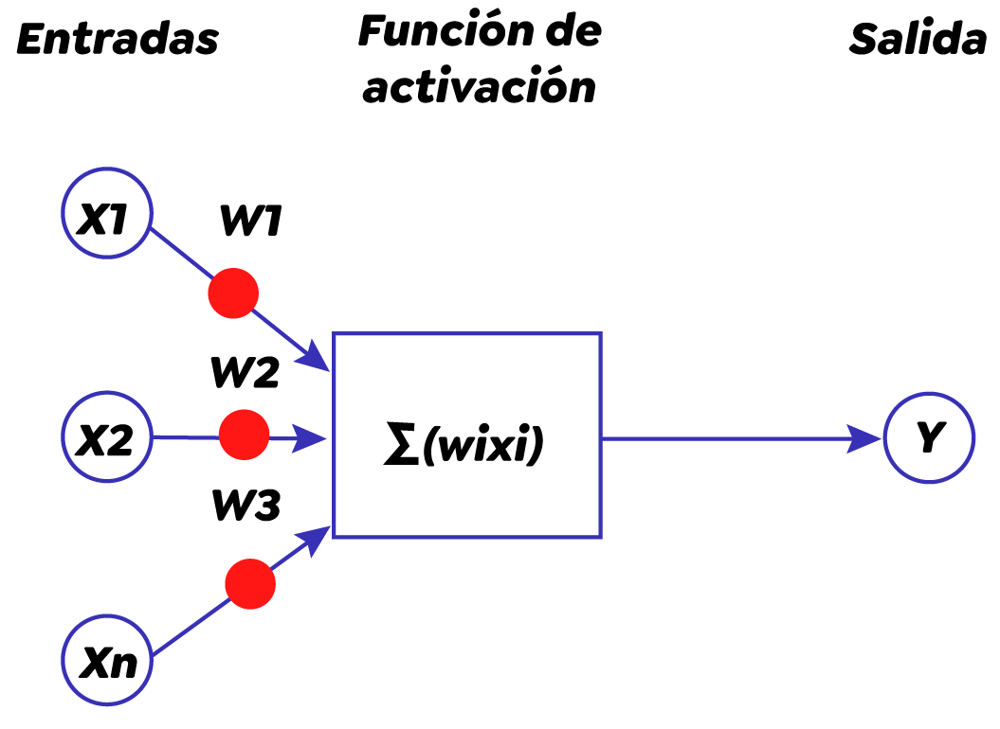
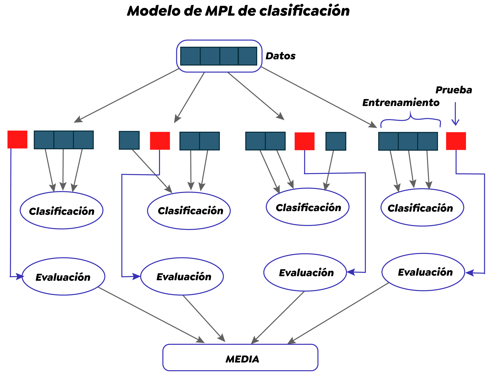
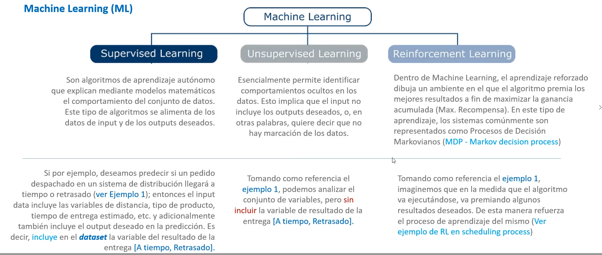
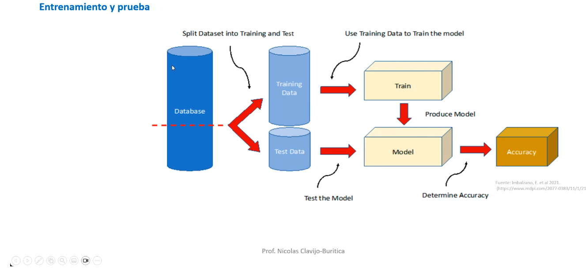
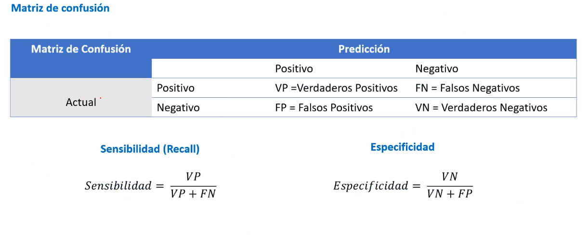
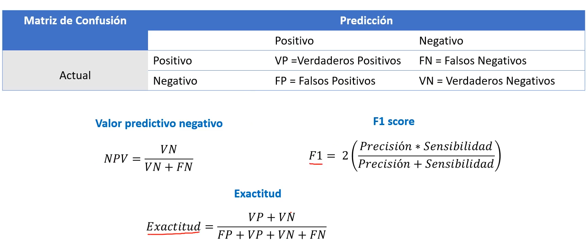
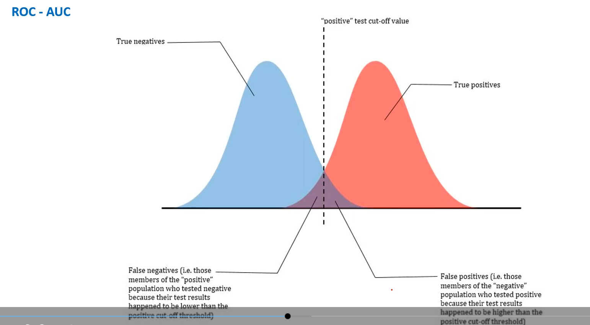

# Aprendizaje Avanzado: Redes Neuronales Artificiales

## ¿Qué es una Neurona Artificial?

Una **neurona artificial** es una unidad básica de una red neuronal artificial que imita el comportamiento de una neurona biológica en el cerebro. 

Se compone de:
* **Entradas**: Señales que recibe la neurona.
* **Pesos sinápticos**: Valores que multiplican las entradas.
* **Conexión de tendencia (bias)**: Valor que se suma al producto de entradas y pesos.
* **Función de activación**: Determina si la neurona se activa o no.

Las entradas se multiplican por los pesos, los productos se suman y se les agrega el valor del *bias*. El resultado se alimenta a través de una función de activación. 

Por medio de la conexión de diferentes neuronas artificiales se pueden crear estructuras mucho más elaboradas llamadas **Redes Neuronales**, las cuales se usan para:
- Procesamiento de información
- Resolver problemas de clasificación
- Regresión en diversas aplicaciones (desde reconocimiento de imágenes hasta análisis de mercado y finanzas).

---

## Generalidades sobre Redes Neuronales Artificiales

La siguiente lectura es fundamental para comprender los conceptos básicos de las redes neuronales artificiales. 
En ella abordarás temas como:
- La neurona biológica y su relación con la neurona artificial.
- Las diferentes arquitecturas de redes neuronales artificiales.
- El proceso de aprendizaje en estas redes.
- Su aplicación en diferentes niveles.

> **Nota:** Es importante que dediques tiempo a la lectura de este capítulo, ya que te permitirá establecer una base sólida para comprender el funcionamiento de las redes neuronales y su aplicación en diversos campos. ¡Adelante con la lectura!

📖 **Lectura:** [Una aproximación práctica a las redes neuronales - Capítulo 1](Una-aproximacion-practica-a-las-redes.pdf)

---

## Material Audiovisual

### 1. La Neurona
En este video aprenderás sobre la neurona artificial y su relación con la biológica, diferentes arquitecturas, el proceso de aprendizaje y su aplicación.
🎥 [Ver video en YouTube](https://www.youtube.com/watch?v=MRIv2IwFTPg&list=PL-Ogd76BhmcB9OjPucsnc2-piEE96jJDQ)

### 2. La Red
Conceptos sobre cómo se estructuran las redes.
🎥 [Ver video en YouTube](https://www.youtube.com/watch?list=PL-Ogd76BhmcB9OjPucsnc2-piEE96jJDQ&v=uwbHOpp9xkc&feature=youtu.be)

## Recursos Adicionales

💻 **Código Python interactivo:** [`Semana_1_Ejemplo_Python_CapadeNeuronasconMatrices.ipynb`](Semana_1_Ejemplo_Python_CapadeNeuronasconMatrices.ipynb)

---
### Red Neuronal Adaline y Algoritmo de Aprendizaje

📖 **Lectura:** [Una aproximación práctica a las redes neuronales - Capítulo 2](Una-aproximacion-practica-a-las-redes.pdf)

### Arquitectura general de un Perceptron Multicapa 

📖 **Lectura:** [Una aproximación práctica a las redes neuronales - Capítulo 3 Pág. 76-86](Una-aproximacion-practica-a-las-redes.pdf)

### Gradiante Descendente

En este video aprenderás sobre el gradiente descendente y su aplicación en redes neuronales.
🎥 [Ver video en YouTube](https://www.youtube.com/watch?v=A6FiCDoz8_4)

## 3. Retropropagación (Backpropagation)

En este video aprenderás sobre la retropropagación y su aplicación en redes neuronales.
🎥 [Ver video en YouTube](https://www.youtube.com/watch?v=eNIqz_noix8&feature=youtu.be)

## Recursos Adicionales
💻 **Código Python interactivo:** [`Semana_2_Ejemplo_Python_ManejoBasicoKeras.ipynb`](Semana_2_Ejemplo_Python_ManejoBasicoKeras.ipynb)

---

### **1. ¿Qué son las redes neuronales MLP (Multilayer Perceptron)?**

Estas son una clase de redes neuronales artificiales que consisten en múltiples capas de neuronas interconectadas, cada una de las cuales realiza una operación matemática simple. Estas redes se utilizan para una variedad de tareas de aprendizaje automático, como clasificación, regresión y predicción. Las redes MLP son particularmente útiles para problemas en los que los datos son complejos y no se pueden modelar fácilmente con modelos lineales simples. Al emplear múltiples capas ocultas, las redes MLP pueden capturar características complejas y no lineales de los datos, lo que las hace ideales para tareas de clasificación y predicción en campos como la visión por computadora, el procesamiento del lenguaje natural, la biología computacional y muchas otras áreas.

## Problemas de Regresión

Un problema de regresión es aquel en el que se busca predecir un valor numérico continuo, como el precio de una casa o la temperatura. Las redes neuronales MLP pueden ser muy efectivas para resolver este tipo de problemas, ya que permiten modelar funciones complejas que relacionan las variables de entrada con las de salida.
  
Generalmente, en una red neuronal MLP de regresión, la capa de salida tiene una única neurona que produce una predicción numérica continua en lugar de una salida binaria. Durante el entrenamiento, la red ajusta los pesos de las conexiones para minimizar el error entre la salida predicha y la salida real.

Este proceso de entrenamiento se basa en el descenso del gradiente y el algoritmo de backpropagation que hemos visto antes. Una vez entrenada, la red neuronal MLP puede usarse para hacer predicciones sobre nuevas entradas.

### **Implementación en Python de una red MLP para problemas de regresión**

[Semana_2_Ejemplo_Python_ManejoBasicoKeras.ipynb](Semana_2_Ejemplo_Python_ManejoBasicoKeras.ipynb)

### **Uso de redes neuronales MLP para resolver problemas de clasificación**

Durante la cuarta semana de la asignatura de aprendizaje automático avanzado, te adentrarás en el uso de redes neuronales MLP para resolver problemas de clasificación. A través de una aplicación práctica, explorarás, por ejemplo, cómo estas redes pueden utilizarse para identificar la cifra escrita a mano en un papel, un ejemplo común de clasificación en el mundo real. A medida que profundices en el uso de redes neuronales MLP en problemas de clasificación, comprenderás cómo estas técnicas pueden ayudarnos a resolver problemas de manera efectiva en diferentes contextos. Al final de la semana, habrás adquirido una comprensión clara y completa de cómo se pueden utilizar las redes neuronales MLP para resolver problemas de clasificación en situaciones cotidianas.

### **Problemas de Clasificación**

Recuerda que redes neuronales MLP, también conocidas como perceptrón multicapa, son una clase de redes neuronales artificiales que se utilizan para resolver problemas de clasificación. Estas redes están formadas por capas de neuronas interconectadas, donde cada neurona recibe entradas de las neuronas de la capa anterior y emite una salida a las neuronas de la capa siguiente. Las redes MLP son capaces de aprender relaciones complejas entre las entradas y las salidas deseadas, lo que las hace ideales para problemas de clasificación en los que se desea predecir la pertenencia de una observación a una o más categorías.

En el ámbito de la inteligencia artificial, las redes neuronales MLP se han convertido en una herramienta poderosa para la resolución de problemas de clasificación en una amplia variedad de campos, como la visión artificial, el procesamiento del lenguaje natural, la bioinformática, entre otros. Al emplear redes MLP para la clasificación, se logran resultados precisos y robustos, incluso en problemas con múltiples clases y variables de entrada complejas.

💻 **Código Python interactivo:** [`Semana_4_Ejemplo_Clasificacion_Iris_MLP.ipynb`](Semana_4_Ejemplo_Clasificacion_Iris_MLP.ipynb)

## Notas Clase 2:

 

